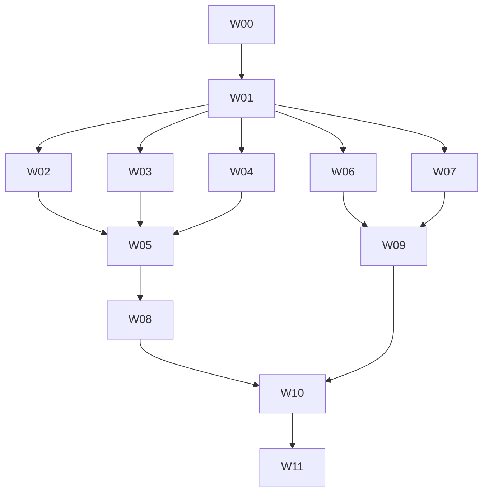

# SDK 대형 출력 최적화 실행 계획

상세 근거: `investigation.md`. 상태: 조사·계획 등록, 제품 구현 착수 전.

## 완료 계약

- 고정 Graph beta의 29,581 operation, 현재 공개 API·wire·검증·오류·선택 경계와 기존 helper omission 계약을 유지한다.
- TS 5.7.3/5.9.3/6.0.3/7.0.2 각각 생성 소스 전체와 전체 공개 consumer를 strict 검사한다. 잘못된 호출도 실제로 거절한다. `skipLibCheck`, `noCheck`, `@ts-nocheck`, broad `any` 추가, 일부 모듈 제외로 성공을 만들지 않는다.
- Go 1.27.2에서 기존 server 포함 38개 제공자와 Graph를 구분해 생성·컴파일·실행 증거를 남긴다. Graph 실패는 별도 실패이며 38개 성공으로 상쇄하지 않는다.
- 성능 이득은 동일 입력·도구·옵션·자원·캐시 경계의 실측으로 판단한다. 추정 바이트 절감과 합성 결과는 제품 완료 근거가 아니다.
- 각 작업은 범위 리뷰 → 원인 수정 → 영향받은 caller·검사 재확인 → 남은 대상 전수 리뷰 → 해당 작업만 커밋한다. 마지막 W11에서 통합 리뷰루프를 수행한다. push·release·배포는 이 계획의 완료 조건에 포함하지 않는다.

## 구현 전 결정 기록

| ID | 결정·기본 방향 | 검증·확정 위치 | 차단하는 작업 |
| --- | --- | --- | --- |
| D01 | 기준 제품 `5ada624`, Graph SHA `46bead9a…daec`, 동일 옵션·operation·helper omission을 기준으로 한다. 실행 시 새 HEAD라면 관련 diff와 basis를 재확인한다. | W00 확정, W01 provenance 재고정 | 전체 |
| D02 | 기본 툴체인과 무관하게 Go 1.27.2, Node `.node-version`, 현재 고정 compiler 네 개를 명시한다. | W01 실제 binary version·hash | 모든 측정 |
| D03 | 자원 예산은 기존 CI runner 안에서 정한다. 제안: 검사 tree RSS 상한 `min(12 GiB, 실제 RAM/cgroup 상한 - 2 GiB)`, TS checker 60분, Go build 60분, serial full-provider, TS7 singleThreaded. 디스크·inode·cgroup·runner 여유를 W01에서 확인하여 manifest에 확정한다. 기준/후보의 상한을 동일하게 적용한다. | W01 사전 smoke. 더 큰 유료 runner나 호스트 설정 변경은 별도 결정 | full-scale 실행 |
| D04 | 성능 채택에는 재현 가능한 compile/size 이득과 correctness가 모두 필요하다. 제안 hot-path 경고선 +5%는 사용자 확정 요구가 아니다. W01에서 기존 benchmark 분산으로 허용 폭을 정하고 W07/W09 측정 전에 기록한다. 불확실하거나 회귀가 일관되면 공유를 채택하지 않는다. | W01 정책 문서, W07/W09 판단 | 성능 기본 적용 |
| D05 | closure는 exact 재사용을 유지하고 projection별 부분집합 base+delta부터 구현한다. 수익 없는 공유·전역 superset·쌍별 전수 교집합은 사용하지 않는다. | W01 분포·비용표 → W02 bounded 알고리즘 | W02 |
| D06 | map의 own key 순서·descriptor reference·prototype과 동일 closure map 재사용을 보존한다. Go ordinal merge, key 중복 거절을 사용한다. | W02 특수 키·projection·dynamic parity | W02 |
| D07 | registry의 단계 순서와 callable identity를 보존한다. state 타입은 한 개이며 청크 크기는 bounded statement/byte 비용으로 비교한다. 공개 경로는 유지한다. | W03 128/256/512 operation 상당 후보와 cross-chunk Link | W03 |
| D08 | section 사전 인덱스는 checker hotspot일 때만 채택한다. 공개 generic의 union/never/resource 의미를 먼저 고정한다. | W04 factorial·양방향 타입 호환/negative 검사 | W04 결과 채택 |
| D09 | 기본 목표는 기존 단일 프로젝트 사용법에서 full strict 성공이다. A/B/C 후에도 실패하면 references를 실제 source ownership·최종 consumer까지 검증한다. 기존 consumer 사용법/배포 계약 변경이 필요하면 구체안·측정 결과를 놓고 결정한다. 실패를 검사 완화로 처리하지 않는다. | W05 실패 분류 → W08 결정 | fallback 제품 통합 |
| D10 | Go 파일 묶기는 최종 package 배치 뒤 공통 sink 앞에 둔다. safe 파일의 명시적 기준·import binding·flush/failure 규약을 먼저 정의한다. 64/128/256 KiB는 후보, 새 public 옵션은 기본적으로 추가하지 않는다. | W06 의미 검사·고정 이름·증분 변경 실측 | W06 |
| D11 | validator는 기존 view 공유 뒤 남은 동일 의미만 대상으로 한다. helper 공유가 partition 배치·type identity를 옮기면 고정 배치 안의 공유로 제한하거나 보류한다. | W07 symbol→package 비교·runtime parity | W07 적용 |
| D12 | fingerprint/manifest 해시는 실제 새 출력과 일치하게 바꾼다. ABI 불변이면 기존 ABI 사용, provider 혼용 거절은 계속 검사한다. 이전 generator로 되돌려 재생성하는 복구 경로를 보장한다. | W02/W06 단위, W10 통합 | 배포 자료 갱신 |

D03/D04는 측정 전 확정할 실험 정책이다. 임의 숫자를 이미 합의된 제품 SLA로 취급하지 않는다. D05/D07/D08/D10/D11은 아래 선행 측정과 조건부 채택으로 해결한다. public API·선택 범위·검사 강도·정의 패키지를 바꾸는 방향은 자동 결정하지 않는다.

## 검증 하네스와 측정 방법

W01에서 기존 SSOT 스크립트에 최적화 실험 전용 진입점을 추가한다. 명령 이름과 인자는 `devtools command list/inspect`로 확인하고 필요한 항목만 등록한다. 아래 `ci:dev`·`compilers:verify`·`golang:perf`는 현재 존재하는 명령이며, 새로운 Graph full strict 명령이 이미 존재한다고 가정하지 않는다.

각 trial manifest는 source commit/dirty diff hash, generator binary hash, input/reference/selection hash, addons, compiler binary와 버전, tsconfig hash, Go/Node/CGO·GOMAXPROCS·메모리 정책, cache 상태, 시간 제한, artifact 수·바이트·해시, exit/signal/timeout/protection 원인과 원시 로그 위치를 기록한다. baseline은 현재 동작을 그대로 사용한다.

TS: 생성과 checker를 별도 프로세스로 끝내고, `extendedDiagnostics`, parse/bind/check, files/symbols/types/instantiations, OS process tree RSS와 exit reason을 수집한다. 지원되는 flag는 compiler별로 탐지한다. `noCheck`는 원인 분류 진단으로만 허용한다. profiling과 대표 timing 표본을 분리한다. TS7 native child는 Node heap과 별도 관측하며 현재 singleThreaded 정책을 유지한다.

Go: 생성 완료/정확성, package별 bytes/files·placement, `.a`, stripped/unstripped consumer, cold 생성 package build와 warm consumer build, 최대 동시 compiler tree RSS, runtime ns/op·B/op·allocs/op·GC·시작 비용을 별개 기록한다. stdlib cache warm 상태에서 생성 패키지 무효화와 완전 cold cache를 혼동하지 않는다. package별 profiling 파일은 서로 덮어쓰지 않는다.

작은/중간 대표 입력은 baseline, A, B, C, A+B, A+B+C 및 Go P, V, P+V를 교차 순서로 각 5회 비교한다. C/V를 보류하면 해당 variant가 없는 이유를 기록한다. 전체 Graph는 먼저 baseline compiler별 1회 smoke, 후보별 실패 분류를 시행한다. 통과 가능한 최종 TS 후보는 compiler별 3회, Go 후보는 5회 반복한다. 양쪽 모두 완료 가능한 비용일 때 full paired A/B를 추가한다. 이미 같은 상한에서 종료된 baseline을 성과 통계용으로 반복하지 않는다. baseline 실패 시 개선율 대신 새 성공 여부와 절대 자원·시간만 보고한다. 실패 표본은 실패 분모에 계속 남기고 완료 표본의 중앙값·범위는 별도 표시한다.

기존 ordinary CI에 대형 성능 측정이나 수치 gate를 강제로 추가하지 않는다. 실제 CI 측정 결과를 공개할 때 해당 run과 입력·compiler·검사 범위를 연결한다. local 결과는 내부 기록으로 유지한다.

## 작업 단위

### W00 — 조사·결정·workstream 계획 확정

첨부 모든 영역, 현재 코드·기존 작업·CI provenance, 의미 보존 재현과 기존 검사 결과를 정리한다. `investigation.md`, 이 계획, 검증 기록, workstream ID 대응을 커밋한다. 구조 검사와 요구사항→수용 기준→작업→검증 연결을 읽어 되확인한다. 현재 요청의 완료 단위다. 제품 구현 작업들은 미완료로 남긴다.

### W01 — 고정 입력 기준선과 동등성·자원 측정 경로 확보

선행 W00. 경로: `scripts/compat-benchmark`, `scripts/perf`, `scripts/verification`, `.github/scripts`, `test/compatibility`, 필요한 `devtools.toml` 선언. 기존 Graph generation-only 결과를 보존하면서 실험 전용 full strict 경로를 추가한다. 실제 closure membership/바이트 분포, Go 최종 package별 파일·bytes·symbol placement를 수집한다. 현재 38개 제공자와 Graph 원본 pins를 고정한다. D02~D05 정책·측정 예산과 고비용 실행 중단 조건을 기록한다.

검증: 작은 실제 SDK로 성공·실제 타입 오류·timeout·signal·보호 종료·로그 부재를 구분한다. 전체 source inventory의 누락 0, 잘못된 consumer 거절, process tree RSS와 parent 포함 범위를 확인한다. 기존 `ci:dev go-core`, 관련 verification 도구 검사와 새 하네스 행동 검사를 수행한다. 리뷰루프 후 `test(perf): establish pinned SDK optimization baselines` 상당 단위 커밋.

### W02 — TypeScript projected closure 부분 공유

선행 W01. 경로: `execution_plan.go`, `execution_schema_modules.go`, `execution_modules.go`, `selective_modules.go`, 관련 plan·loader tests. exact closure 공유를 보존하고 이득이 입증된 subset base+delta를 계획한다. ordinal·projection·deterministic artifact identity를 canonical 계약으로 둔다. planner 시간·메모리도 측정한다.

검증: 빈/단일/동일/부분 겹침/분리 집합·순환·dynamic ref·input/output·Unicode/특수 키, own key 순서·descriptor 동일성·동일 closure map 재사용·선택 import graph subset·두 client 격리. 실제 schema parse/validate 허용·거절과 media 경계를 검사한다. static/dynamic/named/Link consumer, bundler JS/gzip, source strict 네 compiler, deterministic 재방출과 fingerprint 혼용 거절을 재확인한다. 기존 exact emission 문자열 검사는 행동 계약에 맞춰 갱신한다. 리뷰루프 후 `perf(typescript): factor projected execution schema closures`.

### W03 — registry 단계별 함수와 canonical state 타입

선행 W01. 경로: `client_registry.go`, 관련 client/Link/selection tests. 전체 base → links → decoration → 정렬 등록의 단계와 request/client별 state 수명을 보존한다. 청크·stage 사이 값의 타입은 하나의 canonical 계약과 utility/indexed view로 표현한다. 공개 Routes/ID 반환 literal을 유지한다.

검증: 청크 경계 양방향 Link·나중 target resolve·순환 Link, bind 정확히 한 번, callable·pagination·stream·route/ID identity, dependency-only·hidden·operation ID 없음, 특수 키와 공개 key 순서. source strict 네 compiler와 runtime 호출로 확인한다. named·선택 client 호출자도 재검사한다. 리뷰루프 후 `perf(typescript): bound callable registry binding stages`.

### W04 — request section index 효과와 타입 의미 검증

선행 W01. 경로: `route_modules.go`, type helper/runtime consumer tests. route·ID·resource의 정확한 section 목록을 기존 canonical operation 계약에서 생성하는 후보를 비교한다. meaningful checker hotspot과 전체 비용 이득이 없으면 현행 계산을 유지하고 결정 기록만 남긴다.

검증: path/query/header/cookie/body/querystring, body 없음·선택적 body, resource path 제외, hidden·dependency-only, union generic·never·PropertyKey, 잘못된 route·ID·section·parameter name 거절, request/response literal 보존. A/B와 C 추가 비용을 실제 입력으로 비교하고 bytes 증가·RSS·check time을 함께 판정한다. 리뷰루프 후 채택 구현 또는 보류 근거를 단위 커밋.

### W05 — 실제 Graph 전체 strict 검사와 병목 분류

선행 W02/W03/W04. 고정 Graph 전체를 네 compiler에서 동일 strict 설정으로 검사한다. routes/IDs·request/response·public helpers·모델을 사용하는 전체 consumer와 negative consumer를 포함한다. server addon은 동등하게 사용하는 별도 profile로 측정하며 축소 성공으로 바꾸지 않는다.

검증: baseline/A/B/채택 C/조합의 실제 생성과 compiler 결과를 수집한다. parse/bind 규모, semantic hotspot, native-only 회귀, TS2589/2590/2563 등의 실제 오류, timeout·보호 종료를 구분한다. 재현 가능한 오류는 축소 사례를 만든다. 통과 시 W08에 fallback 불필요 근거를 전달하고, 실패 시 graph·largest SCC·declaration dependency를 전달한다. 리뷰루프 후 측정·결정 기록 커밋. 이 작업 완료는 실패 원인과 다음 경로가 확보됐다는 뜻이며 Graph 성공 AC는 W08/W11까지 유지한다.

### W06 — Go 최종 package 안의 안전한 파일 묶기

선행 W01. 경로: `internal/target/golang/emit.go`, `partition.go`, 새 pack 계획/emit 코드, `internal/output` 관련 tests. final partition/import binding 이후 공통 artifact sink를 연결해 분할·비분할·operations·facade를 모두 처리한다. bounded buffering/flush, deterministic path, package별 실패 전파와 제외 파일 규칙을 구현한다. 최종 package membership은 변경하지 않는다.

검증: safe/제외 파일 혼재·import alias 충돌과 local shadowing·iota·comment/directive·큰 단일 선언·empty package·상한 전후·non-Go artifact·final flush·sink fail. 기존 partition consumer의 public type/method/alias·reflect PkgPath·JSON tag를 비교한다. SDK에 operation 하나 추가/삭제, 반복 생성, 실제 stale 파일 제거·수정된 사용자 파일 충돌·write/rename failure rollback을 검사한다. 64/128/256 KiB와 기존 출력의 compile·RSS·증분 변경 폭을 측정한다. 리뷰루프 후 `perf(golang): pack safe declarations after package placement`.

### W07 — Go validator 공유의 실제 중복·identity·runtime 판단

선행 W01. 경로: `plan_schema.go`, `plan_schema_views.go`, `templates/schema.go.tmpl`, runtime/schema·media tests. 이미 공유하는 view를 제외한 lowered 프로그램의 중복률과 바이트를 계량한다. Name·Program ID를 무작정 지우지 않고 동일 알고리즘·binding·direction·media·dialect만 후보로 만든다. 기존 placement가 바뀌면 고정 그룹 내 공유를 비교한다. 이득이 작거나 identity/runtime가 바뀌면 보류한다.

검증: cancellation, recursion/no-progress, path·program identity, media ancestor·JSON no-media 경로, dynamic refs, evaluated-property/item, contentSchema, null/missing/default, 실제 오류 코드·순서·error assertion. schema-hot-path 및 HTTP micro/macro의 ns/op·B/op·allocs/op·GC를 반복 비교한다. 공유의 partition 이동과 caller export data까지 비교한다. 리뷰루프 후 채택 구현 또는 보류 ADR 커밋. codec 공통화·private 이름 축약·새 domain entry는 이 결과를 근거로 별도 제안하며 범위를 자동 확장하지 않는다.

### W08 — Graph 검사 구조 최종 결정과 조건부 fallback

선행 W05. W05가 전체 strict 성공이면 근거와 기존 사용법 유지 결정을 확정한다. 실패 시 public named declaration 계층으로 implementation 의존성을 끊고 실제 module SCC를 DAG로 묶는 최소 references 후보를 검증한다. 각 source의 소유 project는 정확히 하나이고 모든 source를 strict 검사한다. 거대 SCC·전체 public declaration consumer가 예산 안에 들어오는지도 확인한다.

검증: clean `tsc -b --force` 상당 실행·declaration build·negative consumer·NodeNext/Bundler/CommonJS·isolated declarations, fresh clone에서 stale declaration 미사용, incremental 변경 전파와 error exit. 네 compiler와 root public consumer 모두 통과해야 한다. 현재 단일 프로젝트 source 소비나 설치·배포가 바뀌는 경우 구체적 호환안·실측과 결정을 먼저 기록한다. 미해결이면 실패 상태와 선택지를 보존하며 AC-GRAPH를 통과시키지 않는다. 리뷰루프 후 필요한 작은 구현 단위마다 커밋하고 최종 결정 커밋.

### W09 — Go 실제 제공자·Graph compile과 런타임 통합 검증

선행 W06/W07. 정확히 같은 Go 1.27.2·입력·옵션·CGO·캐시·병렬도에서 기존 38개 제공자(server 포함)와 별도 full Graph를 재생성·컴파일한다. 실험 baseline/P/채택 V/P+V의 작은·큰 fixture 및 최종 candidate를 구분한다.

검증: public symbol·defined package·method set·reflect·JSON tag·error identity, JSON/XML/multipart/binary·stream ordering/cancel/close 소유권, 일반/named/selective/dynamic registry. 생성 시간·메모리·files/bytes·package count·`.a`·stripped/unstripped binary·cold/warm 소비자·runtime를 5회 비교한다. Graph timeout/OOM을 숨기지 않으며 full compile 통과가 남으면 AC-GO-FULL은 미충족이다. `ci:dev go-consumers 1 1` 및 기존 `golang:perf`의 해당 모드를 활용한다. 리뷰루프 후 원시 증거와 판단 커밋.

### W10 — 증분 생성·배포 산출물·CI 근거와 문서 일치

선행 W08/W09. 경로: `internal/output`, 필요한 CLI/generate checks, npm source packaging, compatibility/performance reports, EN/KO 사용 문서. 바뀐 파일 배치를 원래 ownership/collision/rollback 규약에 연결한다. 최적화 실제 검사가 통과한 경우에만 CI의 Graph 검증 정책을 수정하고 생성 전용 과거 결과는 그대로 설명한다.

검증: fresh/incremental/no-op/rollback, mixed provider fingerprint 거절·ABI, 공개 import/정확한 타입·server/named/selection, 재현 가능한 archive·해시·source packaging. public 문서의 설치에 TS를 필수화하지 않는다. 로컬 측정·개인 환경을 public benchmark로 게시하지 않는다. 문서 변경 시 `validate:docs`, `build:docs`를 실행하고 public 결과는 실제 Actions run을 연결한다. 리뷰루프 후 코드·문서·근거를 관련 행동 단위로 커밋한다.

### W11 — 최종 통합 리뷰루프와 종료

선행 W10. W00~W10의 최종 commit·결정·검사 basis를 대조한다. 전체 범위를 pending/reviewed/needs-recheck로 나누고 closure/registry/helpers, Go placement/pack/validator/runtime, output/distribution, CI/docs를 모두 리뷰한다. 발견한 필수 결함은 원인을 수정하고 caller와 무효화된 검사만 재수행한 뒤 모든 영역을 다시 완료한다.

필수 검사: `ci:dev go-core`, `ci:dev go-consumers 1 1`, `ci:dev typescript-generator`, `ci:dev typescript-runtime`, `ci:dev typescript-matrix`, `ci:dev typescript-tools`, `compilers:verify all`, `check:dev`, 변경한 문서 검사, W08 full Graph TS 네 compiler, W09 Go 제공자·Graph compile, 실제 성능 증거. 같은 최종 basis에서 이미 통과한 suite는 결과를 재사용하고 불필요하게 중복 실행하지 않는다. release 명령은 실행하지 않는다.

각 코드 수정은 단위 리뷰·검사 후 커밋한다. 마지막에는 통합 리뷰·최종 evidence 갱신을 커밋한다. `git status --short`, unstaged/staged stat·`diff --check`, task-owned/기존 변경 분리를 확인한다. devtools validation basis→실제 결과 record→task done, 전체 수용 기준과 integration validation을 확인한 뒤 workstream close한다. 실패·예산 초과·남은 public 계약 결정은 해당 상태로 남기고 완료로 기록하지 않는다.

## 의존성과 실행 운영

의존성은 입력·증거를 소비하는 관계다. W02/W03/W04, W06/W07의 독립성은 자동 병렬 실행 허가를 뜻하지 않는다. 공유 파일과 성능 측정 자원을 먼저 조정한다. subagent 사용은 별도 요청이 있을 때 결정한다.

기존 workstream `a853d451-82ec-4888-9670-e454521618a3`에는 Graph 경로·기존 계측 작업과 아직 active인 run이 있다. 본 계획은 새 최적화 scope이며 기존 작업과 서로 참조한다. 기존 Cloudflare 작업까지 선행 dependency로 묶거나 기존 claim을 takeover하지 않는다. 구현 전 해당 소유자와 겹치는 파일·검사 산출물 작업을 조정한다.

작업 시작 시 실제 `git status`와 `devtools task current/context`를 확인한다. 현재 정의로 claim하고 context를 비공개로 유지한다. 조건부 후보를 보류할 때 근거·영향·다음 선택지를 기록하고, 수용 기준은 완화하지 않는다. 작업 정의 변경은 revision guard와 dry-run을 거쳐 필요한 validation을 stale로 갱신한다.
