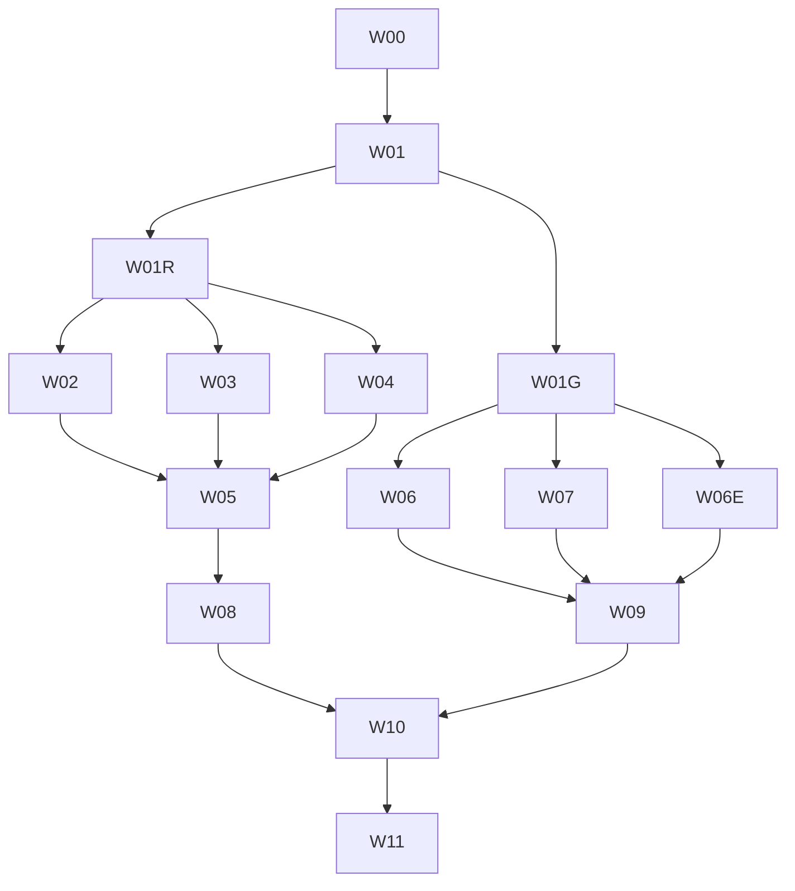

# SDK 대형 출력 최적화 실행 계획

상세 근거: `investigation.md`, `preflight.md`, `execution.md`. 현재 범위는 사용자가 승인한
`scope-decision-2026-10-22.md`를 따른다. 전체 Graph·Cloudflare는 참고 검증이며 corpus
37개 전체·Cloudflare 선택 SDK·Graph 선택 SDK와 최종 통합 수용 기준을 완료한다. 실행 자원 조건은
`execution-policy.md`를 따른다.

## 완료 계약

- 고정 Graph beta의 29,581 operation, 현재 공개 API·wire·검증·오류·선택 경계와 기존 helper omission 계약을 유지한다.
- TS 5.7.3/5.9.3/6.0.3/7.0.2에서 대표 SDK와 Graph 선택 SDK의 생성 source 전체·공개/negative consumer를 strict 검사한다. `skipLibCheck`, `noCheck`, `@ts-nocheck`, broad `any` 추가, 선택된 SDK의 일부 모듈 제외로 성공을 만들지 않는다.
- Go 1.27.2에서 server 포함 corpus 문서 37개(실제 API 문서 28개·fixture 9개) 전체와 Cloudflare·Graph 선택 SDK를 생성·전체 compile·실행한다. 전체 Graph·Cloudflare의 기존 실패는 참고 기록에 그대로 남기며 38개 전체 성공으로 집계하지 않는다.
- 성능 이득은 동일 입력·도구·옵션·자원·캐시 경계의 실측으로 판단한다. 추정 바이트 절감과 합성 결과는 제품 완료 근거가 아니다.
- 각 작업은 범위 리뷰 → 원인 수정 → 영향받은 caller·검사 재확인 → 남은 대상 전수 리뷰 → 해당 작업만 커밋한다. 마지막 W11에서 통합 리뷰루프를 수행한다. push·release·배포는 이 계획의 완료 조건에 포함하지 않는다.

## 구현 전 결정 기록

| ID | 결정·기본 방향 | 검증·확정 위치 | 차단하는 작업 |
| --- | --- | --- | --- |
| D01 | 기준 제품 `5ada624`, Graph SHA `46bead9a…daec`, 동일 옵션·operation·helper omission을 기준으로 한다. 실행 시 새 HEAD라면 관련 diff와 basis를 재확인한다. | W00 확정, W01 provenance 재고정 | 전체 |
| D02 | 기본 툴체인과 무관하게 Go 1.27.2, Node `.node-version`, 현재 고정 compiler 네 개를 명시한다. | W01 실제 binary version·hash | 모든 측정 |
| D03 | 이번 로컬 smoke는 생성 900초, checker·Go build 각 600초, owned session RSS 합 8 GiB, Node heap 7 GiB, GOMAXPROCS=4, TS7 singleThreaded, heavy trial 직렬 실행으로 고정한다. 중단·heap 부족은 이 예산에서의 미완료 결과다. 최종 CI는 runner 가용 RAM/cgroup·2 GiB 여유를 확인하고 별도 manifest에 최대 60분 예산을 사전 고정한다. | W01 `preflight.md`; local과 CI 예산을 섞은 개선율 금지. 유료 runner·호스트 변경은 별도 결정 | full-scale 실행 |
| D04 | correctness·전체 compile 성공을 필수로 하고, 반복 paired 결과와 불확실성을 함께 판단한다. +5%는 runtime 추가 조사 경고선이며 SLA가 아니다. 15% 같은 임의 최소 이득을 통과 gate로 만들지 않는다. 실제 runtime 기준 분산과 허용 폭이 확정되기 전에는 W07 공유를 기본 적용하지 않는다. v2 합성 runtime 95% ratio 상한 1.1139는 비열등성 미입증이다. | W01 정책·남은 gate, W07/W09 실제 runtime 판단 | 성능 기본 적용 |
| D05 | closure는 exact 재사용을 유지하고 projection별 부분집합 base+delta부터 구현한다. 수익 없는 공유·전역 superset·쌍별 전수 교집합은 사용하지 않는다. | W01 분포·비용표 → W02 bounded 알고리즘 | W02 |
| D06 | map의 own key 순서·descriptor reference·prototype과 동일 closure map 재사용을 보존한다. Go ordinal merge, key 중복 거절을 사용한다. | W02 특수 키·projection·dynamic parity | W02 |
| D07 | registry의 단계 순서와 callable identity를 보존한다. state 타입은 한 개이며 청크 크기는 bounded statement/byte 비용으로 비교한다. 공개 경로는 유지한다. | W03 128/256/512 operation 상당 후보와 cross-chunk Link | W03 |
| D08 | section 사전 인덱스는 checker hotspot일 때만 채택한다. 공개 generic의 union/never/resource 의미를 먼저 고정한다. | W04 factorial·양방향 타입 호환/negative 검사 | W04 결과 채택 |
| D09 | 2026-10-22 사용자 결정으로 전체 Graph를 참고 스트레스 사례로 전환한다. 대표 SDK·Graph 선택 SDK는 기존 source 사용법과 동일 strict 계약을 검증하고 references를 소비자의 새 필수 조건으로 추가하지 않는다. 전체 Graph 실패 이력은 보존한다. | `scope-decision-2026-10-22.md` → W08/W09 | 최종 범위 확정 |
| D10 | Go 파일 묶기는 최종 package 배치 뒤 공통 sink 앞에 둔다. safe 파일의 명시적 기준·import binding·flush/failure 규약을 먼저 정의한다. 64/128/256 KiB는 후보, 새 public 옵션은 기본적으로 추가하지 않는다. | W06 의미 검사·고정 이름·증분 변경 실측 | W06 |
| D11 | validator는 기존 view 공유 뒤 남은 동일 의미만 대상으로 한다. helper 공유가 partition 배치·type identity를 옮기면 고정 배치 안의 공유로 제한하거나 보류한다. | W07 symbol→package 비교·runtime parity | W07 적용 |
| D12 | fingerprint/manifest 해시는 실제 새 출력과 일치하게 바꾼다. ABI 불변이면 기존 ABI 사용, provider 혼용 거절은 계속 검사한다. 이전 generator로 되돌려 재생성하는 복구 경로를 보장한다. | W02/W06 단위, W10 통합 | 배포 자료 갱신 |
| D13 | registry 함수만 나누면 남는 대형 타입 파일도 별도로 다룬다. 실제 Graph의 client/types 42.66 MB·routes/index 36.51 MB·selective/types 33.44 MB를 canonical named 계약과 bounded 내부 모듈로 나누는 후보를 검증한다. 공개 Client·RouteCalls·Routes/ID의 literal·generic·declaration 소비를 유지하며 public facade로 연결한다. | W03 별도 단위, W05/W08 전체 checker·consumer | TS 구조 최적화 완료 |
| D14 | 재귀 property와 추가 속성 index union의 기존 TS2456은 성능 후보와 분리해 먼저 해결한다. `objectIndexHasSelfReference`가 additional/pattern만 검사하고 고정 property에서 union에 들어온 self 참조를 놓친다. canonical input/output 계약과 허용·거절 의미를 유지하는 최소 표현 수정을 별도 커밋한다. | W01R의 축소 사례·네 compiler·기존 재귀 검사 | W02/W03/W04 |
| D15 | 2026-10-22 후속 사용자 승인으로 Cloudflare도 선택 SDK 검증으로 전환한다. corpus 37개 전체와 Cloudflare 토큰 확인 선택 API의 전체 compile·HTTP 계약을 필수로 한다. 전체 Cloudflare의 자원 실패는 보존하고 추가 전체 반복은 하지 않는다. | `scope-decision-2026-10-22.md`, `selected-sdk-verification.md` → W09/W11 | 최종 범위 확정 |

D03/D04는 측정 전 확정할 실험 정책이다. 임의 숫자를 이미 합의된 제품 SLA로 취급하지 않는다. D05/D07/D08/D10/D11은 아래 선행 측정과 조건부 채택으로 해결한다. public API·선택 범위·검사 강도·정의 패키지를 바꾸는 방향은 자동 결정하지 않는다.

## 검증 하네스와 측정 방법

W01의 `preflight:perf`는 고정 Go binary 실행, 실패 nonzero, source/binary/input hash와 자원 보호를 제공한다. 사용법과 한계는 `scripts/perf/sdk-optimization/README.md`에 있다. `prepare-ts.mjs`가 생성 소스 전체를 명시하고 strict 옵션을 재사용한다. source 검사 성공 뒤 별도 public/negative consumer가 필요하다. 기존 CI의 Graph generation-only 정책은 이 실험 경로와 구분한다.

각 trial manifest는 source commit/dirty diff hash, generator binary hash, input/reference/selection hash, addons, compiler binary와 버전, tsconfig hash, Go/Node/CGO·GOMAXPROCS·메모리 정책, cache 상태, 시간 제한, artifact 수·바이트·해시, exit/signal/timeout/protection 원인과 원시 로그 위치를 기록한다. baseline은 현재 동작을 그대로 사용한다.

TS: 생성과 checker를 별도 프로세스로 끝내고, `extendedDiagnostics`, parse/bind/check, files/symbols/types/instantiations, OS process tree RSS와 exit reason을 수집한다. 지원되는 flag는 compiler별로 탐지한다. `noCheck`는 원인 분류 진단으로만 허용한다. profiling과 대표 timing 표본을 분리한다. TS7 native child는 Node heap과 별도 관측하며 현재 singleThreaded 정책을 유지한다.

Go: 생성 완료/정확성, package별 bytes/files·placement, `.a`, stripped/unstripped consumer, cold 생성 package build와 warm consumer build, 최대 동시 compiler tree RSS, runtime ns/op·B/op·allocs/op·GC·시작 비용을 별개 기록한다. stdlib cache warm 상태에서 생성 패키지 무효화와 완전 cold cache를 혼동하지 않는다. package별 profiling 파일은 서로 덮어쓰지 않는다.

작은/중간 대표 입력의 기존 교차 5회 비교와 runtime 공유의 판단 근거를 유지한다. C/V를 보류하면 해당 variant가 없는 이유를 기록한다. 관련 코드·입력·도구·조건이 유지되는 표본은 재사용한다. 전체 Graph의 compiler별 3회·Go 5회 반복 조건은 사용자 결정으로 제외한다. 추가 전체 Graph 실험은 진행하지 않고 기존 실패 분모와 원본을 보존한다. Graph 선택 SDK는 correctness·호환성 검증을 수행하며 이를 전체 Graph 성공이나 전체 처리 개선율로 일반화하지 않는다.

기존 ordinary CI에 대형 성능 측정이나 수치 gate를 강제로 추가하지 않는다. 실제 CI 측정 결과를 공개할 때 해당 run과 입력·compiler·검사 범위를 연결한다. local 결과는 내부 기록으로 유지한다.

## 작업 단위

### W00 — 조사·결정·workstream 계획 확정

첨부 모든 영역, 현재 코드·기존 작업·CI provenance, 의미 보존 재현과 기존 검사 결과를 정리한다. `investigation.md`, 이 계획, 검증 기록, workstream ID 대응을 커밋한다. 구조 검사와 요구사항→수용 기준→작업→검증 연결을 읽어 되확인한다. 최초 조사·등록 단위이며 후속 증거로 계획이 바뀌면 현재 정의에서 재검증한다. 제품 구현 작업들은 미완료로 남긴다.

### W01 — 공통 측정 경로와 TypeScript 기준 계약 확보

선행 W00. 공통 recorder·도구 identity·입력 pin·실패 분류와 TS 전체 source/import/closure inventory를 확보한다. 기존 Graph generation-only CI와 실험 strict 경로를 구분한다. 원본 Graph의 공개 route/operation ID 29,581개를 동결하고 public root의 전체 key 동등성 및 negative consumer를 검사할 실행 경로를 만든다. 기존 compiler/runtime·선택 import 경계 검사를 연결하고 작은 실제 SDK로 하네스를 확인한다. 정책은 `execution-policy.md`에 사전 고정한다. Go 최종 package inventory·생성 단계/GC·reflection/runtime 기준 측정은 W01G에서 완료한다.

공통·TS 선행 작업과 Go 선행 작업의 완료 증거를 분리한다. TS 기준 strict 미완료는 실제 결과로 보존하며 최종 성공은 W08/W11에서 충족한다. Go의 미완료 선행 조건을 W01G로 옮겨 같은 수용 기준·전용 validation으로 추적한다. 검증을 삭제하거나 최종 Graph 성공 기준을 완화하지 않는다.

검증: 작은 실제 SDK로 성공·실제 타입 오류·timeout·signal·보호 종료·로그 부재를 구분한다. 전체 source inventory의 누락 0, 잘못된 consumer 거절, process tree RSS와 parent 포함 범위를 확인한다. 기존 `ci:dev go-core`, 관련 verification 도구 검사와 새 하네스 행동 검사를 수행한다. 리뷰루프 후 `test(perf): establish pinned SDK optimization baselines` 상당 단위 커밋.

### W01G — Go 생성·최종 package·런타임 기준 측정

선행 W01. 원래 W01의 Go 선행 검증을 전부 수행한다. corpus 문서 38개와 Graph pin을 고정하고 compile/prepare/emit/format/partition/publish 및 GC 비용을 분리한다. compiler의 6 GiB 정책을 생성 heap 예산으로 자동 복사하지 않는다. 완성된 Graph 출력의 package별 files/bytes·safe pack 후보율·symbol→정의 package·public signature/tag/alias를 동결한다. 전체 생성이 중단되면 일부 stage를 전체 기준선으로 승격하지 않는다.

검증: 기존 Go source/입력이 같은 38개 CI compile correctness는 재사용할 수 있다. 별도 Graph는 새 완성 출력으로 compile을 실제 시도하고 성공·timeout·메모리 보호·compiler 오류를 구분한다. 실제 partition/selected/named·reflection/error/media/cancel 계약과 runtime 기준 표본을 확보한다. 프로파일은 일반 timing과 분리한다. 실패 원인·자원 예산·raw evidence를 검토하고 단위 커밋한다. 후보의 최종 full Graph compile 성공은 W09/W11의 필수 조건으로 남는다.

### W01R — 기존 재귀 property 타입 오류의 선행 수정

선행 W01. 경로: `internal/target/typescript/types.go`, `recursive_type_regression_test.go`, `plans/sdk-optimization/probes/recursive-property.json`. W01 smoke에서 네 compiler 모두 기존 runtime fixture의 Input/Output에 TS2456을 냈다. 추가 속성의 index union에 고정 property의 self 참조가 포함되지만 재귀 index 감지는 additional/pattern만 확인하는 원인을 추적했다. 변경은 출력 표현의 재귀 합법성과 기존 타입 의미를 함께 보존해야 한다. 성능 후보의 회귀로 잘못 분류하지 않는다.

검증: 축소 사례와 원래 runtime fixture를 네 compiler에서 전체 source strict 검사한다. input readonly/optional·output mutable·known property·unknown additional key·mutual/nested recursion·pattern/composition에 대한 허용/거절 consumer와 기존 재귀 검사를 유지한다. `ci:dev typescript-generator` 및 관련 compiler consumer를 실행한다. 리뷰루프 후 독립 correctness 커밋을 만들고 이 소스를 이후 성능 비교의 새 공통 기준으로 재고정한다. 현재 조사에서는 제품 코드를 수정하지 않았다.

### W02 — TypeScript projected closure 부분 공유

선행 W01R. 경로: `execution_plan.go`, `execution_schema_modules.go`, `execution_modules.go`, `selective_modules.go`, 관련 plan·loader tests. exact closure 공유를 보존하고 이득이 입증된 subset base+delta를 계획한다. ordinal·projection·deterministic artifact identity를 canonical 계약으로 둔다. planner 시간·메모리도 측정한다.

검증: 빈/단일/동일/부분 겹침/분리 집합·순환·dynamic ref·input/output·Unicode/특수 키, own key 순서·descriptor 동일성·동일 closure map 재사용·선택 import graph subset·두 client 격리. 실제 schema parse/validate 허용·거절과 media 경계를 검사한다. static/dynamic/named/Link consumer, bundler JS/gzip, source strict 네 compiler, deterministic 재방출과 fingerprint 혼용 거절을 재확인한다. 기존 exact emission 문자열 검사는 행동 계약에 맞춰 갱신한다. 리뷰루프 후 `perf(typescript): factor projected execution schema closures`.

### W03 — registry 단계별 함수와 대형 공개 타입 계약 분할

선행 W01R. 경로: `client_registry.go`, `client_modules.go`, `route_modules.go`, `selective_modules.go`, 관련 client/Link/selection/declaration tests. W03a는 전체 base → links → decoration → 정렬 등록 단계와 request/client별 state 수명을 보존하며 bounded 함수를 만든다. 청크·stage 사이 값의 타입은 하나의 canonical 계약과 utility/indexed view로 표현한다. W03b는 42.66 MB client 타입, 36.51 MB routes index, 33.44 MB selective 타입의 큰 익명 shape·반복 literal 연결을 canonical named 계약과 내부 모듈로 분리한다. exported facade와 정확한 route/ID literal을 유지한다. 각 단위를 따로 리뷰·측정·커밋하고 함수 분할만으로 전체 타입 비용이 해결됐다고 판단하지 않는다.

검증: 청크 경계 양방향 Link·나중 target resolve·순환 Link, bind 정확히 한 번, callable·pagination·stream·route/ID identity, dependency-only·hidden·operation ID 없음, 특수 키와 공개 key 순서. source strict 네 compiler와 runtime 호출로 확인한다. 공개 Client/RouteCalls와 generic route/ID/helper에 대한 양방향 타입 호환, 잘못된 호출 거절, fresh declaration consumer, named·선택 client를 재검사한다. source 파일 크기와 checker 비용을 함께 비교하며, interface extends/intersection으로 부하가 이동하면 원인을 기록한다. 단위 리뷰루프 후 registry와 타입 계약 분할을 각각 커밋한다.

### W04 — request section index 효과와 타입 의미 검증

선행 W01R. 경로: `route_modules.go`, type helper/runtime consumer tests. route·ID·resource의 정확한 section 목록을 기존 canonical operation 계약에서 생성하는 후보를 비교한다. meaningful checker hotspot과 전체 비용 이득이 없으면 현행 계산을 유지하고 결정 기록만 남긴다.

검증: path/query/header/cookie/body/querystring, body 없음·선택적 body, resource path 제외, hidden·dependency-only, union generic·never·PropertyKey, 잘못된 route·ID·section·parameter name 거절, request/response literal 보존. A/B와 C 추가 비용을 실제 입력으로 비교하고 bytes 증가·RSS·check time을 함께 판정한다. 리뷰루프 후 채택 구현 또는 보류 근거를 단위 커밋.

### W05 — 실제 Graph 전체 strict 검사와 병목 분류

선행 W02/W03/W04. 고정 Graph 전체를 네 compiler에서 동일 strict 설정으로 검사한다. routes/IDs·request/response·public helpers·모델을 사용하는 전체 consumer와 negative consumer를 포함한다. server addon은 동등하게 사용하는 별도 profile로 측정하며 축소 성공으로 바꾸지 않는다.

검증: baseline/A/B/채택 C/조합의 실제 생성과 compiler 결과를 수집한다. parse/bind 규모, semantic hotspot, native-only 회귀, TS2589/2590/2563 등의 실제 오류, timeout·보호 종료를 구분한다. 재현 가능한 오류는 축소 사례를 만든다. 통과 시 W08에 fallback 불필요 근거를 전달하고, 실패 시 graph·largest SCC·declaration dependency를 전달한다. 리뷰루프 후 측정·결정 기록 커밋. 이 작업 완료는 실패 원인과 다음 경로가 확보됐다는 뜻이며 Graph 성공 AC는 W08/W11까지 유지한다.

### W06 — Go 최종 package 안의 안전한 파일 묶기

선행 W01G. 경로: `internal/target/golang/emit.go`, `partition.go`, 새 pack 계획/emit 코드, `internal/output` 관련 tests. final partition/import binding 이후 공통 artifact sink를 연결해 분할·비분할·operations·facade를 모두 처리한다. bounded buffering/flush, deterministic path, package별 실패 전파와 제외 파일 규칙을 구현한다. 최종 package membership은 변경하지 않는다.

검증: safe/제외 파일 혼재·import alias 충돌과 local shadowing·iota·comment/directive·큰 단일 선언·empty package·상한 전후·non-Go artifact·final flush·sink fail. 기존 partition consumer의 public type/method/alias·reflect PkgPath·JSON tag를 비교한다. SDK에 operation 하나 추가/삭제, 반복 생성, 실제 stale 파일 제거·수정된 사용자 파일 충돌·write/rename failure rollback을 검사한다. 64/128/256 KiB와 기존 출력의 compile·RSS·증분 변경 폭을 측정한다. 리뷰루프 후 `perf(golang): pack safe declarations after package placement`.

### W07 — Go validator 공유의 실제 중복·identity·runtime 판단

선행 W01G. 경로: `plan_schema.go`, `plan_schema_views.go`, `templates/schema.go.tmpl`, runtime/schema·media tests. 이미 공유하는 view를 제외한 lowered 프로그램의 중복률과 바이트를 계량한다. Name·Program ID를 무작정 지우지 않고 동일 알고리즘·binding·direction·media·dialect만 후보로 만든다. 기존 placement가 바뀌면 고정 그룹 내 공유를 비교한다. 이득이 작거나 identity/runtime가 바뀌면 보류한다.

검증: cancellation, recursion/no-progress, path·program identity, media ancestor·JSON no-media 경로, dynamic refs, evaluated-property/item, contentSchema, null/missing/default, 실제 오류 코드·순서·error assertion. schema-hot-path 및 HTTP micro/macro의 ns/op·B/op·allocs/op·GC를 반복 비교한다. 공유의 partition 이동과 caller export data까지 비교한다. 리뷰루프 후 채택 구현 또는 보류 ADR 커밋. codec 공통화·private 이름 축약·새 domain entry는 이 결과를 근거로 별도 제안하며 범위를 자동 확장하지 않는다.

### W06E — Go operation HTTP 처리문의 AST 절감

선행 W01G. 실제 frontend 비용과 대안은 `operation-batching-decision.md`를 따른다.
기존 package 배치·공개 계약·codec·validator는 유지하고, 반복 매개변수 처리와 응답 선택을
기존 core 함수의 순서 있는 반복으로 표현하는 후보 E를 별도 검증한다. 임시 descriptor는
16개 이하로 나누며 작은 단일 항목은 기존 직접 표현을 유지한다. 파일 묶기 P와 별도 효과다.

검증: header 이름 등록·missing·custom encoder snapshot·첫 오류·취소·묶음 경계·응답
동점/branch index/status/media, 기존 media/stream/ownership 회귀. 기존 모든 정의
package·공개 서명은 그대로이며 새 내부 helper만 정확한 allowlist로 대조한다. 실제 Graph
native AST·전체 compile pilot과 paired HTTP runtime 10쌍을 검증하고 리뷰·커밋한다.
최종 corpus·Graph 선택 SDK와 유효한 대표 표본은 W09/W11에서 확인한다. 전체 Graph는 참고 검증이며 관련 조건을 충족하기 전 기본 적용을 확정하지 않는다.

### W08 — 대표 TS·Graph 선택 SDK와 지원 경계 확정

선행 W05. closure·registry·canonical 계약 개선을 대표 fixture와 실제 Graph 선택 SDK에서 검증한다. 전체 Graph의 기존 source ownership·부분 검사·실패 원인은 참고 근거로 보존하고 추가 전체 실험이나 배포용 references 도입은 진행하지 않는다.

검증: 대표 fixture의 네 compiler·NodeNext/Bundler/CommonJS·독립/isolated declaration·generic/negative consumer·Link/private/순서 회귀와, 고정 Graph 선택 SDK의 전체 source·정확한 공개 key·사용/negative consumer를 검증한다. 선택 route·ID와 원본 pin, server/named/선택 경계를 명시한다. 기존 실패를 성공으로 바꾸지 않으며 원래 source 소비와 TS 선택 설치 계약을 유지한다. 리뷰루프 후 최종 결정과 근거를 커밋한다.

### W09 — Go corpus 37개 전체·Cloudflare/Graph 선택 SDK 검증

선행 W06/W07/W06E. Go 1.27.2·고정 입력·server·기존 compile 정책에서 corpus 문서 37개 전체와 Cloudflare/Graph 선택 SDK를 생성·전체 compile·HTTP 검증한다. baseline/P/E/채택 V와 최종 조합의 대표 fixture를 구분하고, 관련 생성 의존성·입력·도구가 같은 correctness만 재사용한다. 성능 이득은 조건이 유효한 실제 비교 근거로 판단한다.

검증: public symbol·defined package·method set·reflect·JSON tag·error identity, JSON/XML/multipart/binary·stream ordering/cancel/close, 일반/named/selective/dynamic registry를 기존 회귀와 실제 선택 SDK에서 확인한다. 대표 입력의 생성/파일/배포·archive/binary·cold/warm·runtime 근거를 대조하고 조건이 같은 결과만 재사용한다. 전체 Graph 성공·5회 반복과 전체 Cloudflare 성공·추가 반복은 필수가 아니며 기존 실패·미실행 상태를 보존한다. `ci:dev go-consumers 1 1`과 필요한 `golang:perf` 모드를 활용한다.

### W10 — 증분 생성·배포 산출물·CI 근거와 문서 일치

선행 W08/W09. 경로: `internal/output`, 필요한 CLI/generate checks, npm source packaging, compatibility/performance reports, EN/KO 사용 문서. 바뀐 파일 배치를 원래 ownership/collision/rollback 규약에 연결한다. 최적화 실제 검사가 통과한 경우에만 CI의 Graph 검증 정책을 수정하고 생성 전용 과거 결과는 그대로 설명한다.

검증: fresh/incremental/no-op/rollback, mixed provider fingerprint 거절·ABI, 공개 import/정확한 타입·server/named/selection, 재현 가능한 archive·해시·source packaging. public 문서의 설치에 TS를 필수화하지 않는다. 로컬 측정·개인 환경을 public benchmark로 게시하지 않는다. 문서 변경 시 `validate:docs`, `build:docs`를 실행하고 public 결과는 실제 Actions run을 연결한다. 리뷰루프 후 코드·문서·근거를 관련 행동 단위로 커밋한다.

### W11 — 최종 통합 리뷰루프와 종료

선행 W10. W00~W10의 최종 commit·결정·검사 basis를 대조한다. 전체 범위를 pending/reviewed/needs-recheck로 나누고 closure/registry/helpers, Go placement/pack/validator/runtime, output/distribution, CI/docs를 모두 리뷰한다. 발견한 필수 결함은 원인을 수정하고 caller와 무효화된 검사만 재수행한 뒤 모든 영역을 다시 완료한다.

필수 검사: `ci:dev go-core`, `ci:dev go-consumers 1 1`, `ci:dev typescript-generator`, `ci:dev typescript-runtime`, `ci:dev typescript-matrix`, `ci:dev typescript-tools`, `compilers:verify all`, `check:dev`의 SSOT 통합 검사, 변경한 문서 검사, W08 대표 TS·Graph 선택 SDK 네 compiler, W09 Go corpus 37개 전체·Cloudflare/Graph 선택 SDK, 유효한 대표 성능 근거. 같은 최종 basis에서 통과한 suite는 재사용하고 중복 실행하지 않는다. 전체 Graph·Cloudflare 추가 반복·release 명령은 실행하지 않는다. devtools 포트 준비가 vault 잠금으로 차단되면 비밀값 없는 기존 측정 명령이 준비한 동일 환경에서 `scripts/dev/check.sh`를 직접 구성 실행하고 원래 명령의 차단을 함께 기록한다.

각 코드 수정은 단위 리뷰·검사 후 커밋한다. 마지막에는 통합 리뷰·최종 evidence 갱신을 커밋한다. `git status --short`, unstaged/staged stat·`diff --check`, task-owned/기존 변경 분리를 확인한다. devtools validation basis→실제 결과 record→task done, 전체 수용 기준과 integration validation을 확인한 뒤 workstream close한다. 실패·예산 초과·남은 public 계약 결정은 해당 상태로 남기고 완료로 기록하지 않는다.

## 의존성과 실행 운영

의존성은 입력·증거를 소비하는 관계다. 공통 W01 뒤에 Go W01G와 TS W01R을 분리한다. 각 언어의 선행 증거를 해당 구현 작업에서 요구한다. 무거운 성능 trial은 직렬로 실행하고 공유 파일의 변경을 조정한다. subagent 사용은 별도 요청이 있을 때 결정한다.

기존 workstream `a853d451-82ec-4888-9670-e454521618a3`에는 Graph 경로·기존 계측 작업과 아직 active인 run이 있다. 본 계획은 새 최적화 scope이며 기존 작업과 서로 참조한다. 기존 Cloudflare 작업까지 선행 dependency로 묶거나 기존 claim을 takeover하지 않는다. 구현 전 해당 소유자와 겹치는 파일·검사 산출물 작업을 조정한다.

작업 시작 시 실제 `git status`와 `devtools task current/context`를 확인한다. 현재 정의로 claim하고 context를 비공개로 유지한다. 조건부 후보를 보류할 때 근거·영향·다음 선택지를 기록하고, 수용 기준은 완화하지 않는다. 작업 정의 변경은 revision guard와 dry-run을 거쳐 필요한 validation을 stale로 갱신한다.
